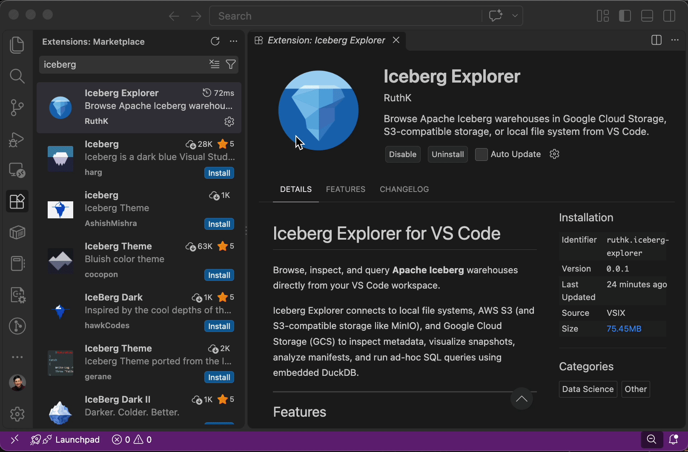

# Iceberg Explorer for VS Code

Browse, inspect, and query **Apache Iceberg** warehouses directly from your VS Code workspace.

Iceberg Explorer connects to local file systems, AWS S3 (and S3-compatible storage like MinIO), and Google Cloud Storage (GCS) to inspect metadata, visualize snapshots, analyze manifests, and run ad-hoc SQL queries using embedded DuckDB.

---

## Features

- **Sidebar Navigation**: Browse namespaces, tables, views, snapshots, and manifest files directly from the VS Code Explorer.
- **Flexible Storage**: Connect to local file systems, AWS S3 / MinIO, and Google Cloud Storage (ADC or service account keys).
- **Metadata & Schema Inspection**: Inspect schema evolution, partition specs, manifest lists, interactive SVG snapshot DAGs, and raw metadata JSON.
- **In-IDE SQL Queries**: Run ad-hoc queries against Parquet data files using embedded DuckDB-WASM with instant tabular previews.
- **Secure Storage**: Credentials are saved exclusively in VS Code's Keychain-backed SecretStorage.

---

## Quick Start

### 1. Open the Explorer
Click the **Explorer** icon (`Cmd+Shift+E` / `Ctrl+Shift+E`) in the VS Code Activity Bar and expand the **Iceberg Explorer** view at the bottom of the sidebar.

### 2. Add a Connection
Click the **Add Connection** button (or the **`+`** icon in the view title) to open the Connection Settings panel:
* **Local**: Provide the local absolute path to your warehouse directory (use **Browse** or **Auto-Detect** to find Iceberg roots).
* **S3**: Enter your bucket name, optional prefix, region, credentials, and custom endpoint URL (if using MinIO/LocalStack).
* **GCS**: Enter your bucket name, prefix, and select your authentication method (ADC or Service Account Key).

### 3. Explore & Query
* **Connect**: Click **Connect** on your configured connection to make it active and open the Connection Dashboard.
* **Browse Tables**: Expand namespaces and tables in the sidebar to reveal schema, metadata versions, and data files.
* **Inspect Details**: Right-click or click on any table to open the **Table Overview**, **Schema Overview**, or **Metadata Structure**.
* **Query Data**: Open the **Ad-hoc Query** panel or click **Query** from the Table Overview to run SQL queries against underlying Parquet files.

---

## Extension Commands

All commands can be triggered via the VS Code Command Palette (`Cmd+Shift+P` / `Ctrl+Shift+P`):

| Command | Description |
|---|---|
| `Iceberg Explorer: Add Connection` | Open connection manager to add a new warehouse |
| `Iceberg Explorer: Connect` | Connect to a saved warehouse connection |
| `Iceberg Explorer: Disconnect` | Disconnect the active warehouse connection |
| `Iceberg Explorer: Edit Connection` | Edit an existing warehouse connection |
| `Iceberg Explorer: Delete Connection` | Delete a saved warehouse connection |
| `Iceberg Explorer: Open Connection Dashboard` | View and manage configured warehouse connections |
| `Iceberg Explorer: Open Table Overview` | Display table summary, properties, partitions, and metrics |
| `Iceberg Explorer: Open Schema Overview` | View column definitions, types, and schema roster |
| `Iceberg Explorer: Open Metadata Structure` | Inspect snapshot DAG, manifest hierarchy, and metadata JSON |

---

## System Requirements

* **VS Code**: Version `1.96.0` or later
* **Platform**: Cross-platform (macOS, Linux, Windows)

---

## Development & Contributing

Looking to build from source, run tests, or contribute to the extension? See [CONTRIBUTING.md](CONTRIBUTING.md) for prerequisites, build scripts, and architecture details.

---

## License

This project is licensed under the Apache License 2.0. See the [LICENSE](LICENSE) file for details.
